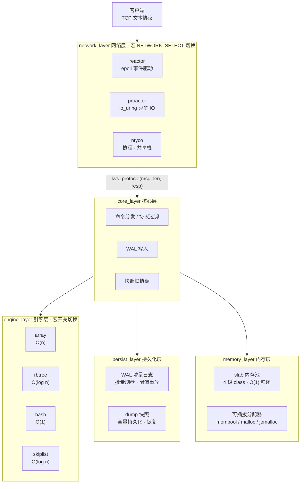

# 9.1-KVStore

基于 C 语言从零实现的高性能 KV 存储服务(类 Redis),支持**多种索引引擎、网络 IO 模型、内存分配器可配置切换**,覆盖完整的存储、并发、持久化技术栈,核心代码约 3500 行。

## ✨ 核心特性

| 模块 | 特性 |
| --- | --- |
| **存储引擎** | 数组、手写红黑树、哈希表、跳表 4 种引擎,宏开关一键切换,覆盖 O(n) / O(log n) / O(1) 查询场景 |
| **网络层** | 3 种 IO 模型可切换对比:epoll reactor(事件驱动)、io_uring proactor(异步 IO)、协程(移植开源协程库 [NtyCo](https://github.com/wangbojing/NtyCo),共享栈 + 栈拷贝切换) |
| **持久化** | WAL 增量持久化(批量刷盘,减少磁盘 IO)+ dump 快照全量持久化(对标 Redis AOF + RDB);启动时快照加载 + WAL 重放完成崩溃恢复;快照线程与写操作互斥锁协调 |
| **内存管理** | 自研 slab 内存池(32/64/128/256 四级 class,chunk 头反查实现 O(1) 归还);分配器可插拔(mempool / 原生 malloc / jemalloc) |
| **工程化** | 六层解耦、回调接口抽象、宏开关 A/B 对比、自研压测客户端统计 QPS |

## 🏗 架构设计



**一次写请求的处理路径**

1. 客户端发送 `SET key value` → 网络层收到数据并回调 `kvs_protocol`
2. 核心层解析命令、匹配引擎,写操作前加持久化锁
3. 执行引擎写入(数组 / 红黑树 / 哈希 / 跳表)
4. 写成功后把命令追加进 WAL 缓冲,攒够 `KVS_WAL_BATCH_SIZE` 条统一刷盘
5. 释放锁,向客户端返回 `OK`

## 📁 目录结构

```
.
├── core_layer/            #   核心层:命令分发、协议过滤、main
├── engine_layer/          #   引擎层:array / rbtree / hash / skiptable
├── network_layer/         #   网络层:reactor(epoll)/ proactor(io_uring)/ ntyco(协程)
├── persist_layer/         #   持久化层:WAL + 快照
├── protocol_layer/        #   协议解析层
├── memory_layer/          #   内存层:slab 内存池
├── include/               #   公共头文件 + 全部配置宏
├── NtyCo/                 #   协程库(开源,移植集成)
├── my_testcase.c          #   压测客户端(QPS 统计)
└── Makefile
```

## 🔨 编译与运行

依赖:`gcc`、`liburing`(io_uring)、`jemalloc`、`pthread`。

```bash
make            # 生成 kvstore(服务端) 和 my_testcase(压测客户端)

./kvstore 9001  # 启动服务端,监听 9001 端口
```

## ⚙️ 配置开关(include/kvstore.h)

| 宏 | 取值 | 说明 |
| --- | --- | --- |
| `NETWORK_SELECT` | `NETWORK_REACTOR` / `NETWORK_PROACTOR` / `NETWORK_NTYCO` | 网络 IO 模型三选一 |
| `PERSIST_MODE` | `PERSIST_MODE_ENABLE` / `PERSIST_MODE_DISABLE` | 持久化开关 |
| `MEM_ALLOC_MODE` | `MEM_ALLOC_MEMPOOL` / `MEM_ALLOC_RAW` / `MEM_ALLOC_JEMALLOC` | 内存分配器三选一 |
| `ENABLE_ARRAY` / `ENABLE_RBTREE` / `ENABLE_HASH` / `ENABLE_SKIPTABLE` | `0` / `1` | 引擎裁剪开关 |
| `KVS_WAL_BATCH_SIZE` | 整数 | WAL 批量刷盘阈值 |
