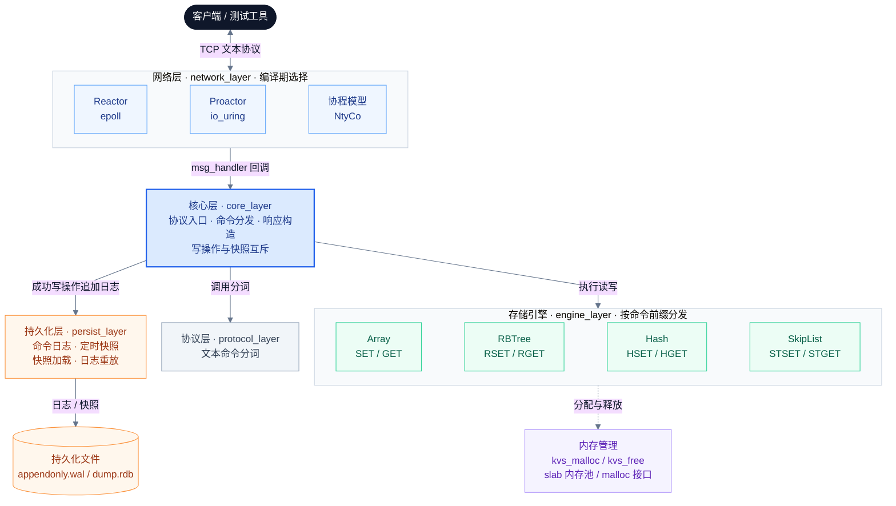

# KVStore

**基于 Linux / C 的内存键值存储服务，围绕索引结构、网络 I/O、内存分配与持久化开展系统编程实践。**

项目提供数组、红黑树、哈希表和跳表四种存储引擎，通过 TCP 文本命令完成键值读写；网络层提供 epoll Reactor、io_uring Proactor 和 NtyCo 协程三种实现，并通过统一回调接入命令处理逻辑。

包含基础功能测试、串行吞吐统计和持久化恢复流程。使用自定义协议，不兼容 Redis RESP。

## 核心特性

| 方向 | 实现内容 |
| --- | --- |
| 多种索引结构 | Array、RBTree、Hash、SkipList；各引擎独立保存数据，按命令前缀分发请求 |
| 网络 I/O | epoll 就绪事件驱动、io_uring 完成事件驱动、基于 NtyCo 的协程处理 |
| 模块解耦 | 网络层通过 `msg_handler` 调用核心层；快照通过遍历回调访问引擎中的键值对 |
| 持久化 | 命令追加日志、定时全量快照、启动时快照加载与日志重放 |
| 内存管理 | 统一 `kvs_malloc / kvs_free` 入口；实现 32 / 64 / 128 / 256 字节四档 slab 内存池 |
| 测试工具 | TCP 测试客户端，校验命令响应，并为部分测试模式统计耗时、操作数和 QPS |

## 架构设计

项目按职责划分为六个模块。协议层负责分词，核心层负责命令识别、引擎调用和响应构造；网络层通过回调接入核心处理流程。



实线表示主要交互或调用，虚线表示内存分配依赖。图中省略响应返回、快照遍历和恢复路径。内存分配封装位于 `core_layer/kvstore.c`，slab 实现位于 `memory_layer/mempool.c`。

### 一次写请求的处理过程

以 `STSET user:1 Alice` 为例，在启用持久化时：

1. 网络层接收请求，通过 `msg_handler` 回调调用 `kvs_protocol()`。
2. `kvs_split_token()` 按空格分词，`kvs_filter_protocol()` 识别命令。
3. 核心层获取持久化互斥锁，调用跳表引擎执行插入。
4. 插入成功后，将原命令追加到日志流；累计达到阈值时调用 `fflush()`。
5. 核心层释放锁，网络层发送响应。

读请求直接访问对应引擎，不追加命令日志。当前四种引擎并存，`SET user:1 Alice` 与 `STSET user:1 Alice` 操作的是不同数据集合。

## 快速开始

### 环境与依赖

- Linux，GCC、GNU Make。
- `liburing` 开发库：编译 io_uring 网络实现。
- `jemalloc` 开发库：当前 Makefile 的链接依赖。
- pthread、libdl；NtyCo 源码已包含在仓库中。
- Python 3：仅用于下方可选的交互演示。

Ubuntu / Debian 可使用以下命令安装依赖：

```bash
sudo apt update
sudo apt install -y build-essential git liburing-dev libjemalloc-dev python3
```

当前 Makefile 会编译三种网络实现并链接相关库，即使只选择其中一种运行，也需要安装上述构建依赖。使用 Proactor 模式时，运行环境还需要支持并允许相应的 io_uring 操作。

### 编译与启动

```bash
git clone https://github.com/linux-lin17/kv_store.git
cd kv_store

make
./kvstore 9001
```

`make` 构建 NtyCo 静态库，并生成 `kvstore` 服务端和 `my_testcase` 测试客户端。当前构建规则建议使用串行 `make`。

请在仓库根目录启动服务，持久化文件使用相对路径 `persist_layer/`。默认配置为 **NtyCo 网络模型、四种引擎全部启用、持久化开启**。

NtyCo 模式监听指定端口；Reactor 和 Proactor 实现会尝试监听从指定端口开始的连续 20 个端口。例如传入 `9001` 时，对应 `9001–9020`。

### 发送请求

保持服务端运行，在另一个终端执行：

```bash
python3 - <<'PY'
import socket
import uuid

key = "demo_" + uuid.uuid4().hex
commands = [
    f"STSET {key} Alice",
    f"STGET {key}",
    f"STMOD {key} Bob",
    f"STGET {key}",
    f"STEXIST {key}",
    f"STDEL {key}",
    f"STGET {key}",
]

with socket.create_connection(("127.0.0.1", 9001), timeout=5) as sock:
    with sock.makefile("rb") as replies:
        for command in commands:
            sock.sendall(command.encode())
            reply = replies.readline()
            if not reply:
                raise RuntimeError("server closed the connection")
            print(command, "=>", reply.decode().rstrip("\r\n"))
PY
```

该示例的预期响应依次为 `OK`、`Alice`、`OK`、`Bob`、`EXIST`、`OK`、`NO EXIST`。

当前协议没有完整的 TCP 消息分帧逻辑。演示采用本机短请求，每次等待响应后再发送下一条；这不能替代对拆包、粘包的处理。请求不要额外附加换行符，当前解析器不会统一去除请求末尾的 `\r\n`。

## 命令协议

命令区分大小写，使用大写命令名，以空格分隔参数。当前面向不包含空格和换行的字符串键值，不支持二进制数据、引号或转义语法。

| 操作 | Array | RBTree | Hash | SkipList | 参数 |
| --- | --- | --- | --- | --- | --- |
| 新增 | `SET` | `RSET` | `HSET` | `STSET` | `key value` |
| 查询 | `GET` | `RGET` | `HGET` | `STGET` | `key` |
| 修改 | `MOD` | `RMOD` | `HMOD` | `STMOD` | `key value` |
| 删除 | `DEL` | `RDEL` | `HDEL` | `STDEL` | `key` |
| 存在性检查 | `EXIST` | `REXIST` | `HEXIST` | `STEXIST` | `key` |

响应以 `\r\n` 结尾，可能为值字符串或 `OK`、`EXIST`、`NO EXIST`、`ERROR`。

`SET` 系列用于新增，更新已有键应使用 `MOD` 系列。当前重复插入、删除不存在键等边界行为尚未在所有引擎间统一，详见改进计划。

## 配置方式

主要配置位于 [include/kvstore.h](include/kvstore.h)，修改后需要重新编译。

| 配置项 | 当前默认值 | 说明 |
| --- | --- | --- |
| `NETWORK_SELECT` | `NETWORK_NTYCO` | 可选择 `NETWORK_REACTOR`、`NETWORK_PROACTOR`、`NETWORK_NTYCO` |
| `PERSIST_MODE` | `PERSIST_MODE_ENABLE` | 是否启用日志、快照和恢复流程 |
| `MEM_ALLOC_MODE` | `MEM_ALLOC_RAW` | 分配封装的编译分支：`MEM_ALLOC_MEMPOOL`、`MEM_ALLOC_RAW`、`MEM_ALLOC_JEMALLOC` |
| `ENABLE_ARRAY` | `1` | 数组引擎声明与核心调用开关 |
| `ENABLE_RBTREE` | `1` | 红黑树引擎声明与核心调用开关 |
| `ENABLE_HASH` | `1` | 哈希表引擎声明与核心调用开关 |
| `ENABLE_SKIPTABLE` | `1` | 跳表引擎声明与核心调用开关 |
| `KVS_WAL_BATCH_SIZE` | `10` | 日志追加计数达到阈值时调用 `fflush()` |

其他参数包括：数组容量 `KVS_ARRAY_SIZE = 1024`、哈希桶数 `MAX_TABLE_SIZE = 1024`、跳表最高层号 `MAX_LEVEL = 6`。快照间隔 `SNAPSHOT_INTERVAL_SEC = 10` 位于 `persist_layer/my_wal.c`。

```bash
# 修改配置后重新构建；当前 Makefile 没有自动跟踪头文件依赖
make clean
make
```

配置有两点需要配合构建规则使用：

- **引擎裁剪**：引擎源文件仍全部列在 `COMMON_SRCS` 中。关闭某个 `ENABLE_*` 时，还需同步移除对应源文件或完善条件编译，不能只修改宏就假定可以完成裁剪。
- **分配器对比**：`RAW` 与 `JEMALLOC` 分支当前都调用 `malloc/free`，而 Makefile 无条件链接 `-ljemalloc`。仅修改宏不能保证切换到两个不同的实际分配器；进行性能对比前需要调整链接配置并验证符号绑定。

## 实现要点

### 存储引擎

四种引擎提供相似的增删改查接口，由核心层的 `switch` 直接调用，并分别提供 `foreach` 遍历接口供快照使用。

| 引擎 | 实现方式 | 特点与边界 |
| --- | --- | --- |
| Array | 固定容量数组、线性查找 | 查找为 O(n)，用于基础实现与对照 |
| RBTree | 左右旋、插入修复、删除修复、哨兵节点 | 利用平衡树控制树高，查找为 O(log n) |
| Hash | 固定 1024 个桶、链地址法处理冲突 | 当前哈希函数为字符求和取模，无动态扩容；耗时受冲突链长度影响 |
| SkipList | 多级前向指针、随机层高 | 当前最高层号固定为 6，规模增大时需调整层高配置 |

哈希表不能无条件宣称查找为 O(1)；跳表通常所说的期望 O(log n) 也需要合适的随机层高与最大层数配置。表中不包含字符串比较及复制的长度成本。

### 网络模型

| 实现 | 工作方式 | 源码 |
| --- | --- | --- |
| Reactor | 非阻塞 socket 配合 epoll，按就绪事件调用 accept / recv / send 回调；当前使用 LT | [my_reactor.c](network_layer/my_reactor.c) |
| Proactor | 提交 accept / recv / send 请求到 io_uring，根据 CQE 结果推进连接处理 | [my_proactor.c](network_layer/my_proactor.c) |
| NtyCo | 连接处理运行在协程中，通过 socket hook、epoll 和协程调度衔接 I/O 等待 | [my_ntyco.c](network_layer/my_ntyco.c) |

三种实现均接收 `msg_handler`，复用同一套核心协议处理逻辑。当前服务端没有业务线程池；启用持久化后，会额外启动一个快照线程。

集成的 NtyCo 默认使用 `ucontext`，通过共享栈与栈内容保存、恢复实现协程切换。协程运行库来自第三方项目，本仓库负责将其接入 KV 请求处理流程。

### 持久化与恢复

持久化实现位于 [persist_layer](persist_layer)，包含两类文件：

| 文件 | 内容 | 用途 |
| --- | --- | --- |
| `appendonly.wal` | 按行记录成功执行的写命令 | 启动时通过核心协议入口重放 |
| `dump.rdb` | 按引擎分区记录文本键值对 | 启动时恢复全量数据 |

文件名沿用日志与快照的常见命名，但这里的 `dump.rdb` 是自定义文本格式，不兼容 Redis RDB。

启动顺序为：**初始化引擎 → 加载快照 → 重放日志 → 打开追加日志 → 启动快照线程 → 启动网络服务**。重放期间通过标志位阻止命令再次写入日志。

快照线程每轮等待 10 秒，获取与写请求相同的互斥锁，遍历所有启用的引擎生成快照，然后截断日志。生成快照期间写请求会等待锁。

当前持久化语义：

- 命令日志在内存写操作成功后追加，并非严格的 write-ahead 顺序。
- `fflush()` 将 C 标准 I/O 缓冲中的数据交给操作系统，当前没有调用 `fsync/fdatasync`；返回 `OK` 不代表数据已可靠落盘。
- 日志初次打开时设为全缓冲，快照截断后重新打开时改为行缓冲，因此实际刷新行为并不始终只由批量阈值决定。
- 快照直接覆盖目标文件，且当前未依据快照成功与否决定是否截断日志；原子替换、失败处理和崩溃一致性仍需完善。

### slab 内存池

[memory_layer/mempool.c](memory_layer/mempool.c) 为小对象提供四档可用空间：`32 / 64 / 128 / 256` 字节。

- 空闲链表不足时，申请 4096 字节内存块并切分为固定大小的 chunk。
- 每个 chunk 前有元数据头，记录所属档位；释放时通过用户指针回退找到头部，归还空闲链表。
- 超过 256 字节的请求回退到 `malloc`，并保留头部标记以便统一释放。
- 内存池销毁时遍历各档位的 page 链表，释放已申请的内存块。

空闲 chunk 的取出与归还通过链表头操作完成。该内存池尚未实现独立的线程同步及通用分配器所需的完整对齐保证。

## 测试与吞吐统计

测试客户端位于 [my_testcase.c](my_testcase.c)，调用格式为：

```bash
./my_testcase <server_ip> <port> <mode>

# 跳表基础功能测试
./my_testcase 127.0.0.1 9001 5

# 红黑树：10000 轮，每轮 9 次操作
./my_testcase 127.0.0.1 9001 0
```

测试模式与源码中的分支对应：

| mode | 测试内容 | 操作数 | 输出 QPS |
| --- | --- | --- | --- |
| `0` | 红黑树，重复执行新增 / 查询 / 修改 / 检查 / 删除等操作 | 90,000 | 是 |
| `1` | 红黑树，批量新增 10,000 个键，再查询、修改 | 30,000 | 是 |
| `2` | 数组，重复执行基础操作 | 90,000 | 是 |
| `3` | 哈希表基础功能测试 | 9 | 否 |
| `4` | 跳表，重复执行基础操作 | 90,000 | 是 |
| `5` | 跳表基础功能测试 | 9 | 否 |
| `6` | 与 mode 3 相同，调用哈希表基础测试 | 9 | 否 |
| `7` | 跳表与哈希表各写入 100,000 个键，并查询、修改 | 600,000 | 是 |
| `8` | 红黑树写入、查询并修改 `Teacher` | 3 | 否 |
| `9` | 查询跳表 `Teacher1024` 与哈希表 `Teacher1717` | 2 | 否 |

测试需启用对应引擎，并满足测试键的初始状态要求。mode 1、7、8 会保留数据；mode 9 依赖 mode 7 生成的数据。mode 9 仅检查两个键，不能代表完整的崩溃恢复验证。

当前测试程序使用**单个 TCP 连接串行发送请求并等待响应**，统计公式为：

```text
QPS = 操作总数 × 1000 / 耗时毫秒数
```

`BEGIN_TEST` 默认是 `1`，每次通过都会打印日志。进行吞吐对比时应设为 `0` 并重新编译，避免终端输出干扰。默认 KVStore 构建参数为 `-Wall -g`，没有启用优化选项；比较不同配置时应保持编译参数一致。

仓库暂未提供固定环境下的性能结果。记录测试结果时，应同时给出 CPU、Linux 内核、编译参数、网络模型、实际分配器、持久化开关、数据规模和测试模式。现有串行测试结果不代表多连接并发吞吐上限。

## 目录结构

```text
kv_store/
├── core_layer/
│   └── kvstore.c                 # 主函数、命令分发、分配器封装
├── network_layer/
│   ├── my_reactor.c              # epoll Reactor
│   ├── my_proactor.c             # io_uring Proactor
│   └── my_ntyco.c                # NtyCo 接入
├── protocol_layer/
│   └── my_protocol_parsing.c     # 文本命令分词
├── engine_layer/
│   ├── my_kvs_array.c            # 数组
│   ├── my_kvs_rbtree.c           # 红黑树
│   ├── my_kvs_hash.c             # 哈希表
│   └── my_kvs_skiptable.c        # 跳表
├── persist_layer/
│   ├── my_wal.c                 # 命令日志、重放、快照线程与锁
│   ├── my_snapshot.c            # 全量快照写入与加载
│   ├── appendonly.wal           # 日志数据
│   └── dump.rdb                 # 快照数据
├── memory_layer/
│   └── mempool.c                # slab 内存池
├── include/                     # 配置宏、类型定义和模块接口
├── NtyCo/                       # 第三方协程库及其示例
├── my_testcase.c                 # TCP 功能测试与串行吞吐统计
└── Makefile
```

## 当前边界与改进计划

当前版本已串联网络请求、内存索引和持久化恢复流程，后续优先完善正确性与可复现测试：

- [ ] 补齐 TCP 分帧、参数与长度检查、未知命令响应，以及部分读写处理。
- [ ] 修正引擎边界问题，包括哈希桶初始化、数组删除空洞、红黑树不存在键删除和重复插入的处理；补充内存释放与分配失败测试。
- [ ] 增加日志错误检查、同步策略、快照原子替换及失败时保留日志的机制，并进行故障注入测试。
- [ ] 完善连接表容量管理、文件描述符越界检查、网络错误处理与协程参数生命周期。
- [ ] 补充退出信号处理，使日志收尾与资源清理能够在正常停机时执行。
- [ ] 完善引擎裁剪、分配器链接切换、头文件依赖和并行构建规则。
- [ ] 增加自动化回归、内存检查、多连接压测和可复现的性能对比记录。

## 第三方组件

协程运行库来自 [wangbojing/NtyCo](https://github.com/wangbojing/NtyCo)，本项目保留在 `NtyCo/` 目录中，负责集成其调度与 socket hook 能力。目录中的 HTTP、MySQL、Redis 等示例属于第三方库示例，不代表 KVStore 已实现相应功能。

io_uring 用户态接口使用 liburing；当前构建链接 jemalloc。第三方组件的作者信息与版权声明见对应源码。
